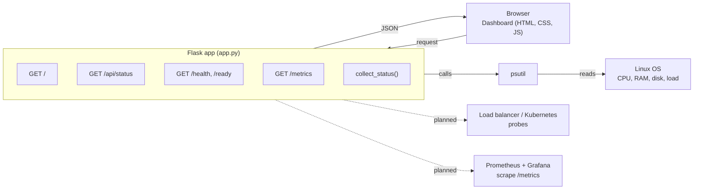
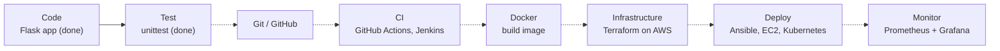

## Hi Health Monitor App
## DevOps Health Monitor

A Flask web app that reports the health of the server it runs on (CPU, memory, disk, load,
uptime) on a colourful live dashboard. It also exposes health, readiness and Prometheus
endpoints so that each DevOps tool has a real job to do with it.

> **Status:** the application, dashboard and unit tests are complete. Docker, CI/CD,
> Terraform + AWS, Kubernetes and monitoring are planned next, as hands-on DevOps tasks.

## What it does

- Reads CPU, memory, disk, load average and uptime using **psutil**
- Shows them on a live dashboard (ring gauges, history chart, system info) that refreshes every 3 seconds
- Marks a metric as a **warning** when it passes a configurable threshold, and the overall state as **degraded**
- Provides `/health`, `/ready` and `/metrics` endpoints for load balancers, Kubernetes and Prometheus

## How it was built

1. **Flask skeleton:** created the app and the routes for the dashboard and API.
2. **Metric collection:** a `collect_status()` function uses psutil to read CPU, memory, disk and load.
3. **Health logic:** thresholds come from environment variables. A metric above its limit is a warning, and the overall state becomes "degraded".
4. **Probe endpoints:** `/health` and `/ready` for load balancers and Kubernetes, `/metrics` in Prometheus text format.
5. **Dashboard:** vanilla JavaScript fetches `/api/status` every 3 seconds and redraws the rings and the chart.
6. **Tests:** unit tests check every endpoint and the threshold logic, so a CI pipeline can run them.

## Workflow diagrams

### 1. How the app works



### 2. DevOps pipeline roadmap



Solid arrows are finished. Dotted arrows are planned.

## Endpoints

| URL | Purpose | Used by |
|---|---|---|
| `/` | Live dashboard | You, in the browser |
| `/api/status` | Full status as JSON | Dashboard, scripts, Ansible |
| `/health` | Liveness check, 200 if the app runs | Load balancer, Docker, Kubernetes (planned) |
| `/ready` | Readiness check, 503 if CPU or RAM is 95% or more | Kubernetes, deployments (planned) |
| `/metrics` | Prometheus text format | Prometheus, Grafana (planned) |

## Run locally (Ubuntu)

```bash
cd health-monitor
python3 -m venv venv
source venv/bin/activate
pip install -r requirements.txt
python app.py
```

Open http://127.0.0.1:5000

## Run the tests

```bash
python -m unittest discover -s tests -v
```

## Configuration (environment variables)

| Variable | Default | Meaning |
|---|---|---|
| `PORT` | `5000` | Port to listen on |
| `HOST` | `127.0.0.1` | Use `0.0.0.0` inside Docker or on servers |
| `APP_ENV` | `development` | Shown on the dashboard (dev / staging / prod) |
| `APP_VERSION` | `1.0.0` | Shown on the dashboard, can be set from CI |
| `CPU_THRESHOLD` | `80` | Warning level in % |
| `MEMORY_THRESHOLD` | `80` | Warning level in % |
| `DISK_THRESHOLD` | `85` | Warning level in % |
| `LOG_LEVEL` | `INFO` | Logging level |

Example: `PORT=8080 APP_ENV=staging python app.py`

## Production-style start (gunicorn)

```bash
gunicorn -w 2 -b 0.0.0.0:5000 app:app
```

## DevOps learning roadmap

| # | Tool | Task |
|---|---|---|
| 1 | **Git / GitHub** | Push the project, use feature branches and pull requests |
| 2 | **Linux / Bash** | Run it on Ubuntu, write a Bash script that curls `/health`, create a systemd service |
| 3 | **Docker** | Write a `Dockerfile` using gunicorn, build the image, run with `-e` variables and `-p` ports |
| 4 | **GitHub Actions** | Run the tests on every push, then build the Docker image |
| 5 | **Jenkins** | Build the same pipeline: checkout, test, build image, push to Docker Hub |
| 6 | **Terraform** | Reuse the VPC + ALB + ASG project and set the ALB health check path to `/health` |
| 7 | **AWS** | Run the container on EC2, then try ECR for image storage |
| 8 | **Ansible** | Playbook that installs Docker on the servers and runs the container |
| 9 | **Kubernetes** | Deployment + Service, with `/health` as liveness and `/ready` as readiness probes |
| 10 | **Prometheus + Grafana** | Scrape `/metrics`, build a dashboard, set an alert for high CPU |

Tip: after each step, add a short section here with a screenshot. It becomes portfolio proof.

## Tech stack

Python | Flask | psutil | HTML5 | CSS3 | JavaScript | unittest | gunicorn

## Project structure

```
health-monitor/
├── app.py                  # Flask app, metric collection and routes
├── requirements.txt
├── .gitignore
├── README.md
├── templates/index.html    # Dashboard, about section, workflow diagrams
├── static/
│   ├── style.css
│   └── app.js              # Polls /api/status, draws rings and chart
└── tests/test_app.py
```
## Recent Improvements

- Improved project documentation.
- Added details about application features.
- Updated project setup instructions.
## Author

**Usama Gohar** | [GitHub](https://github.com/Usama1442) | [LinkedIn](https://linkedin.com/in/usama-gohar-a33a35339)
