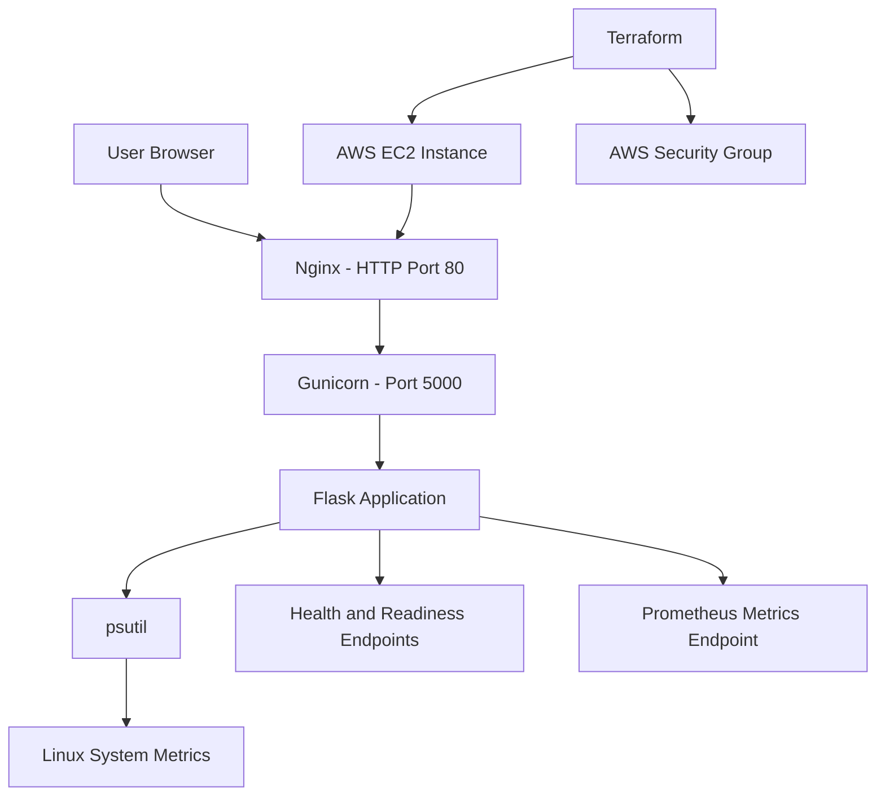

# OpsPulse Health Monitor

A DevOps portfolio project that monitors server health through a live web dashboard and demonstrates application deployment using Docker, Terraform, AWS EC2, Nginx, and Gunicorn.

**Author:** Usama Gohar  
**GitHub:** [Usama1442](https://github.com/Usama1442)  
**Repository:** [opspulse-health-monitor](https://github.com/Usama1442/opspulse-health-monitor)  
**LinkedIn:** [Usama Gohar](https://linkedin.com/in/usama-gohar-a33a35339)

---

## Project Overview

OpsPulse Health Monitor is a Python Flask application that collects system metrics and displays them on a live dashboard. It monitors CPU usage, memory, disk utilization, system load, and uptime.

The project is also used to practice DevOps workflows, including Linux administration, Git/GitHub, Docker, infrastructure provisioning with Terraform, AWS deployment, and configuration management.

## Features

- Live dashboard for server health and system metrics.
- CPU, memory, disk, load average, and uptime monitoring.
- Configurable thresholds for detecting resource warnings.
- JSON status API for application and system information.
- Health and readiness endpoints for deployment checks.
- Prometheus-format metrics endpoint.
- Unit tests for application endpoints and health logic.
- Docker configuration for containerized execution.
- Terraform configuration for AWS EC2 infrastructure.
- Nginx reverse proxy with Gunicorn application serving.

## Technology Stack

| Category | Technology |
|---|---|
| Application | Python, Flask |
| System metrics | psutil |
| Frontend | HTML, CSS, JavaScript |
| Application server | Gunicorn |
| Web server / reverse proxy | Nginx |
| Testing | Python unittest |
| Version control | Git, GitHub |
| Containerization | Docker |
| Cloud | AWS EC2 |
| Infrastructure as Code | Terraform |
| Additional DevOps work | Kubernetes, Ansible, Jenkins |

## Architecture



The application runs behind Gunicorn, while Nginx accepts HTTP requests and forwards them to the application. Terraform provisions the AWS infrastructure used for the deployment.

## Application Endpoints

| Endpoint | Purpose |
|---|---|
| `/` | Opens the monitoring dashboard |
| `/api/status` | Returns current system status in JSON |
| `/health` | Checks whether the application is responding |
| `/ready` | Reports application readiness based on configured checks |
| `/metrics` | Exposes metrics in Prometheus text format |

## Run Locally on Ubuntu

### Prerequisites

- Python 3
- Git
- pip and Python virtual environment support

### Installation

Clone the repository:

```bash
git clone https://github.com/Usama1442/opspulse-health-monitor.git
cd opspulse-health-monitor
```

Create and activate a virtual environment:

```bash
python3 -m venv .venv
source .venv/bin/activate
```

Install dependencies:

```bash
pip install -r requirements.txt
```

Start the application:

```bash
python app.py
```

Open the dashboard at:

`http://127.0.0.1:5000`

## Run the Tests

Run the unit tests from the project root:

```bash
python -m unittest discover -s tests -v
```

The tests cover application endpoints and health-check logic.

## Docker

The repository includes a Dockerfile and Docker Compose configuration for containerized execution.

Docker is used to package the application and its dependencies into a portable container.

Build and run instructions should be kept aligned with the current Dockerfile and `compose.yaml`.

## AWS Deployment with Terraform

The project includes Terraform configuration for provisioning AWS resources.

### Infrastructure

- **EC2:** Ubuntu-based virtual server running the application.
- **Security Group:** Allows inbound HTTP traffic on port 80.
- **Gunicorn:** Serves the Flask application internally on port 5000.
- **Nginx:** Acts as a reverse proxy from port 80 to Gunicorn.

### Deployment workflow

```bash
cd terraform
terraform init
terraform validate
terraform plan
terraform apply
```

Review the plan before approving resource creation. Terraform will ask for confirmation before applying changes.

### Cleanup

When the infrastructure is no longer needed:

```bash
terraform destroy
```

Review the deletion plan and confirm it before proceeding.

**Cost note:** AWS resources can incur charges while running. Destroying Terraform-managed resources removes those resources, but previously accrued charges and charges from other active resources may remain.

**Current deployment status:** The EC2 deployment was successfully created and the website was verified in a browser. The resources were subsequently destroyed to avoid ongoing infrastructure costs. The website is therefore not currently hosted on that EC2 instance.

## Repository Structure

```text
opspulse-health-monitor/
├── app.py
├── requirements.txt
├── requirements-dev.txt
├── Dockerfile
├── compose.yaml
├── Jenkinsfile
├── ansible/
├── k8s/
├── screenshots/
├── static/
├── templates/
├── tests/
├── terraform/
├── .dockerignore
├── .gitignore
├── .flake8
└── README.md
```

## DevOps Roadmap

- [x] Build the Flask monitoring application and dashboard.
- [x] Add health, readiness, and metrics endpoints.
- [x] Add application tests.
- [x] Create Terraform configuration for AWS infrastructure.
- [x] Deploy the application to AWS EC2 and verify browser access.
- [x] Destroy the AWS resources after testing.
- [x] Push the project and Terraform configuration to GitHub.
- [ ] Verify the final Docker build and container workflow.
- [ ] Verify Kubernetes deployment and service behavior.
- [ ] Configure and verify an automated CI/CD pipeline.
- [ ] Complete Ansible deployment automation.
- [ ] Integrate Prometheus and Grafana for metrics visualization and alerting.
- [ ] Add deployment screenshots and final test results.

## Learning Outcomes

This project provides hands-on practice with:

- Linux application deployment and service management.
- Git and GitHub version control.
- Python application testing.
- Docker containerization.
- Terraform infrastructure provisioning.
- AWS EC2 and Security Group configuration.
- Nginx reverse proxy and Gunicorn.
- Kubernetes health probes and deployment concepts.
- CI/CD and monitoring concepts.

## Author

**Usama Gohar**

- GitHub: https://github.com/Usama1442
- LinkedIn: https://linkedin.com/in/usama-gohar-a33a35339
